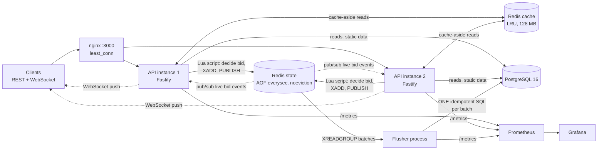
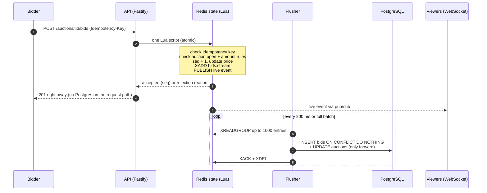
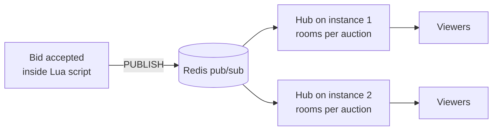

# Real-Time Auction Backend

A real-time auction backend built step by step as a learning project: **Node 22 + TypeScript + Fastify + PostgreSQL + Redis**, with live bids over WebSockets, a Redis **write-behind** bid path, nginx load balancing, idempotency keys, and Prometheus/Grafana observability.

Every performance claim below was measured with k6 on a single laptop (4 cores / 8 threads, load generator, Docker, Postgres and Redis all sharing it). The raw output is in [`results/`](results) and each experiment has a written report in [`docs/`](docs).

## Headline numbers

| Measure | Result |
|---|---|
| One hot auction at 1,000 req/s | **0% failed requests**, median 2.9 ms, p95 60 ms, 64,762 bids accepted |
| 100 auctions at 1,000 req/s | **0% failed**, median 2.7 ms, p95 13 ms |
| Postgres CPU during the hot-auction test | **~16%** |
| Failure drill (flusher killed, Redis killed) | **7,637 bids acknowledged, 7,637 saved, 0 lost / 0 duplicated / 0 seq gaps** |
| Throughput at saturation (one API instance) | **~3,445 req/s** |
| Median bid latency at ~1,800 req/s | **1.6 ms** (p95 5 ms) |
| Cached reads | hit ratio **98.7%** |
| WebSockets | **5,000 concurrent sockets, 100% delivery**, ~8-9 KB per idle socket |
| Log volume | **0.7 MB** per 2-minute load run |

All figures are single-laptop measurements (4 cores / 8 threads shared with the load generator, Docker, Postgres and Redis); saturated runs vary by roughly +-7% or more. Raw output is in [`results/`](results), written reports in [`docs/`](docs).

## Architecture



Two Redis instances on purpose: the **cache** Redis may evict and lose data, the **state** Redis is the source of truth for live bids, never evicts, and persists with AOF.

## The bid path: write-behind

Writing every bid to Postgres under a row lock turns one hot auction into a single-row lock queue. Instead, Redis decides each bid atomically and a separate flusher saves them to Postgres in batches.



Why it is safe:

- **Atomic decision.** The Lua script runs as one step in Redis, so concurrent bids from any instance cannot both win. A race test fires identical and different amounts from both instances at once and checks a gapless, strictly rising sequence.
- **Idempotent flush.** The SQL is `INSERT ... ON CONFLICT DO NOTHING` plus an update that only moves forward. If the flusher crashes before `XACK`, the entries are re-read and re-applied with no duplicates.
- **Fail closed.** If Redis is down, bids get `503`. They never fall back to Postgres, because that would create two competing sources of truth.
- **Reads stay fresh.** Reads overlay the live price/bidder/seq from Redis on top of the cached Postgres row, so users see the right price even while Postgres lags by about one flush.

### Failure drill

`scripts/wb-drill.ts` sends traffic from 30 concurrent clients while it `SIGKILL`s the flusher and `docker kill`s the state Redis.

| Result | |
|---|---|
| Bids answered 201 | 7,637 |
| Saved in Postgres | 7,637 |
| Acknowledged but missing / different / duplicated | 0 / 0 / 0 |
| Auctions with a seq gap or wrong `bid_count` | 0 / 0 |
| Bids refused with 503 while Redis was down | 2,253 (correct: fail closed) |
| Flush lag in steady state | ~200-300 ms (max 4.7 s while both were down) |

### Honest limits

- A **power cut** can lose up to ~1 s of acknowledged bids (AOF `everysec`); not simulated. Options: `appendfsync always`, a replica, or accepting the risk.
- If Redis loses writes that Postgres kept, seq numbers can collide. The flusher detects and counts these (`conflictTotal`, log `flush.conflict`) but does not repair them.
- Postgres lags Redis by about one flush, so WebSocket history replay and the 2 s auction-list cache can be slightly behind.

## Real-time updates



- `WS /auctions/:id/live[?lastSeq=N]` sends a snapshot, then replays missed bids if `lastSeq` is given.
- Every bid has a gapless per-auction `seq`. Client rule: apply an event only if `seq > lastSeq`; a jump larger than +1 means reconnect with `lastSeq`.
- Heartbeat pings, per-IP and global connection limits, and backpressure (a slow client is dropped when its buffer grows too large).
- Measured: 5,000 sockets, 100% delivery. One hot auction with 5,000 viewers pushes bid POST p50 to ~130 ms because fan-out blocks the event loop.

## Reports

| Report | Topic |
|---|---|
| [Redis reads](docs/loadtest-report-2-redis-reads.md) | Cache-aside for auction reads |
| [WebSockets](docs/loadtest-report-3-websockets.md) | 5,000 sockets, fan-out cost |
| [Write-behind](docs/loadtest-report-5-write-behind.md) | Redis decides bids, flusher saves to Postgres, failure drill |
| [nginx, two instances](docs/loadtest-report-6-nginx-two-instances.md) | Balancing and failover |
| [Lean logging](docs/loadtest-report-7-logging.md) | Sampled production logging |
| [Observability](docs/report-8-observability.md) | Prometheus metrics, Grafana dashboard |
| [Idempotency and throughput](docs/report-9-idempotency-and-throughput.md) | Idempotency keys, publish-in-script, batching |

## Idempotent bids

Send `Idempotency-Key: <unique string>` with `POST /auctions/:id/bids`. A retry with the same key returns the original answer (header `Idempotent-Replayed: true`) and never places a second bid; the same key with a different request is `422`. The check runs inside the same atomic Lua script, so 20 simultaneous copies of one request produce exactly one bid (tested). Keys cost ~150 bytes each in the never-evicting state Redis, so a guard returns `503 IDEMPOTENCY_STORE_FULL` to keyed requests above 80% memory.

## API

| Method | Path | Notes |
|---|---|---|
| POST | `/users` | `{name}` |
| POST | `/auctions` | `{sellerId, title, startingPrice, durationSeconds}` |
| GET | `/auctions`, `/auctions/:id` | cached, live price overlaid from Redis |
| POST | `/auctions/:id/bids` | `{bidderId, amount}`, optional `Idempotency-Key` |
| WS | `/auctions/:id/live?lastSeq=N` | live bids |
| GET | `/health/live`, `/health/ready`, `/health/stats` | health and counters |
| GET | `/metrics` | Prometheus (per instance; nginx hides it) |
| GET | `/demo` | dev demo page (not registered in production) |

Money is stored as `BIGINT` minor units.

## Run it

Requirements: Node 22, Docker Desktop.

```bash
cp .env.example .env
npm install
docker compose up -d        # Postgres, cache Redis, state Redis, nginx
npm run migrate
npm run dev                 # API on http://localhost:3000
npm run flusher             # second terminal: saves bids from Redis to Postgres
```

Behind nginx with two instances (compiled):

```bash
npm run cluster:start       # flusher + api-3001 + api-3002 + nginx on :3000
npm run cluster:status
npm run cluster:stop
```

Monitoring (optional): `npm run obs:up` gives Grafana at http://localhost:3030 and Prometheus at http://localhost:9090.

Tests (real Postgres and Redis):

```bash
npm test                          # write-behind path (default), 29 tests
BID_IMPL=single npm test          # one-statement Postgres path
```

Useful scripts: `scripts/wb-drill.ts` (failure drill), `scripts/race-check.ts` (two-instance race), `scripts/cluster-check.ts`, `loadtest/` (k6 scripts and runners), `lab-ui/` (a web console with buttons that create load and failures while you watch Grafana).

## Project layout

```
src/server.ts        entry, graceful shutdown
src/app.ts           Fastify setup, error handler, health routes
src/state.ts         Lua scripts and live state (write-behind authority)
src/flusher.ts       batch writer: Redis stream to Postgres
src/cache.ts         cache-aside, request coalescing, fail-open
src/realtime/        WebSocket routes and hub
src/modules/         users, auctions, bids
src/metrics*.ts      Prometheus metrics
migrations/          numbered SQL files
nginx/ grafana/ prometheus/   infrastructure config
loadtest/ results/ docs/      k6 scripts, raw results, written reports
tests/               Vitest integration and concurrency tests
```

## Status

Phases 1 to 4 (REST + Postgres, tests, caching, real-time) are done, plus write-behind bidding, nginx, lean logging, observability and idempotency. Next: **Phase 5**, ending auctions with BullMQ queues (closing an auction must drain the flusher first and mark it ended in Redis). Not done yet: authentication and rate limiting (Phase 6), a separate test database.

## Stack

Node 22, TypeScript (ESM), Fastify, PostgreSQL 16, Redis (ioredis), `@fastify/websocket`, pino, zod, `pg` (raw SQL, no ORM), prom-client, Prometheus, Grafana, nginx, Vitest, k6.
